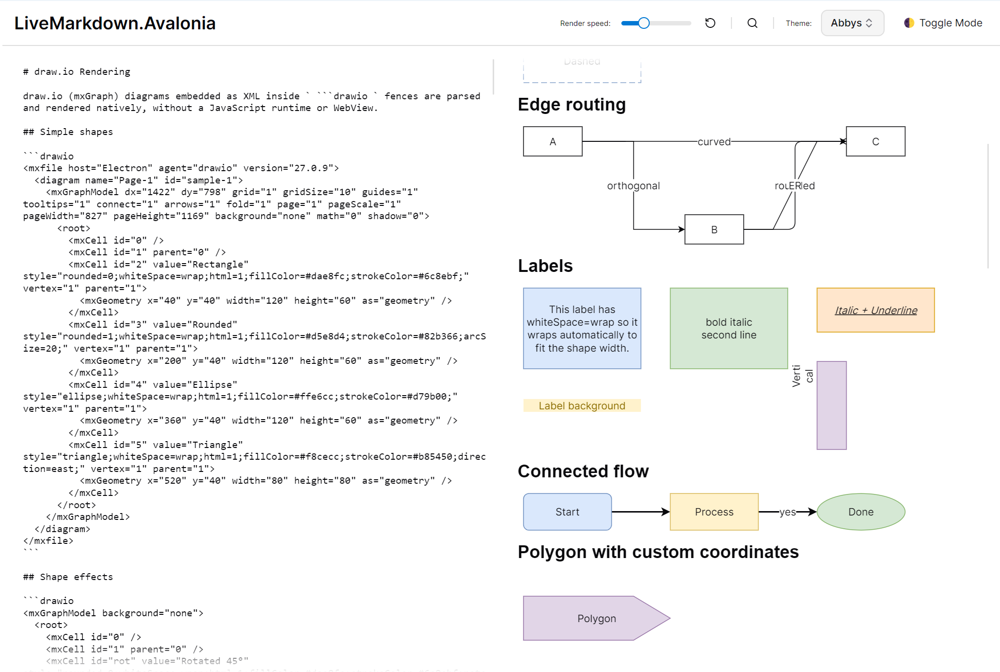

# LiveMarkdown.Avalonia.DrawIo



LiveMarkdown.Avalonia.DrawIo is the **draw.io extension for
[LiveMarkdown.Avalonia](https://github.com/DearVa/LiveMarkdown.Avalonia)**.
It natively renders [draw.io](https://www.drawio.com/) (mxGraph) diagrams,
written in Markdown code fences, as Avalonia controls **without a JavaScript
runtime or WebView**.

The draw.io XML is parsed in C# and drawn directly via `DrawingContext`, using
the geometry and style information embedded in the diagram.

## About

This repository is the **draw.io (`mxGraph`) rendering extension** for
[LiveMarkdown.Avalonia](https://github.com/DearVa/LiveMarkdown.Avalonia).
It plugs into the LiveMarkdown pipeline (`UseDrawIo()`), registers a
`DrawIoBlockNode`, and draws the diagram natively with Avalonia — **no
JavaScript runtime and no WebView**.

| Package | Description |
| --- | --- |
| [`LiveMarkdown.Avalonia`](https://github.com/DearVa/LiveMarkdown.Avalonia) | Core Markdown renderer for Avalonia (required dependency). |
| `LiveMarkdown.Avalonia.DrawIo` (this repo) | Extension that renders ` ```drawio ` fenced blocks as native draw.io diagrams. |

- 🔗 Core project: <https://github.com/DearVa/LiveMarkdown.Avalonia>
- 🔗 draw.io: <https://www.drawio.com/>

## Features

- 🔌 **Markdown integration** — Detects ` ```drawio ` fences and renders the embedded draw.io XML.
- 🧩 **Native rendering** — No JS / WebView required. Runs on pure C# + Avalonia only.
- 📄 **Multi-format input** — Supports both plain `<mxGraphModel>` XML and the default `<mxfile>` wrapper, including the compressed (base64 + deflate) `<diagram>` payload.
- 🎨 **Shape support** — Rectangles, rounded rectangles, ellipses, and a broad set of basic preset shapes: rhombus, hexagon, parallelogram, trapezoid, step, cylinder, cloud, actor, internal storage, document, manual input, card, note, callout, double/single arrow, double ellipse, line, process, loop limit, off-page connector, tape, delay, cube, display, data storage, terminator, predefined process, sequential data, multi-document, stored data, manual operation, merge/storage, OR/AND/XOR gates, cross, star, octagon, pentagon, tee, folder — plus generic polygons (`mxgraph.basic.polygon` / `polyCoords` with optional quadratic curves).
- 🏷️ **Rich labels** — HTML labels with `<b>`/`<i>`/`<span style="color:…">`/`<br>` markup, `%Placeholder%` attribute substitution, `fontStyle` bits (bold/italic/underline), `whiteSpace=wrap` word wrapping, vertical text (`horizontal=0`) and label background.
- ✨ **Shape effects** — `rotation`, `flipH`/`flipV`, `gradientColor`, `opacity`/`fillOpacity`/`strokeOpacity`, `shadow`, `glass`, and custom `dashPattern`.
- ➡️ **Edges** — Orthogonal / ER / elbow routing, `rounded=1` corners, `curved=1` smoothing, `jumpStyle=arc` intersection jumps, edge labels, and a broad marker vocabulary (`classic`/`block`/`open`/`oval`/`diamond`/`async`/`box`/`dash`/`cross`/`circle`/`circlePlus`/`doubleBlock` and the ER markers `ERone`/`ERmandOne`/`ERmany`/`ERoneToMany`/`ERzeroToOne`/`ERzeroToMany`), with `startFill`/`endFill` and `startSize`/`endSize`.
- 🗂️ **Pages, layers and visibility** — Selects a page via `PageIndex`; honours hidden cells (`visible="0"`), collapsed containers and layer assignment.
- 🖼️ **Image cells** — Renders `shape=image` / `image=data:image/...` cells from inline data URIs.
- 🧩 **Generic stencil engine** — A native port of draw.io's `mxStencil` XML grammar (`save`/`restore`, `path`/`move`/`line`/`quad`/`curve`/`arc`/`rect`/`roundrect`/`ellipse`, `fill`/`stroke`/`fillstroke`, style keys). Register any stencil set via `DrawIoStencil.RegisterStencilSet(xml)` and the presenter renders it instead of the rectangle fallback. A subset of `mxgraph.flowchart.*` (terminator, predefined process, decision, document, database, manual input/operation, preparation, off-page reference, internal storage, delay, display, stored data, loop limit, sequential data, sort) is bundled and auto-registered.
- 🔄 **Streaming support** — Shows the source text while the fence is open, and switches to the rendered diagram once it is closed.

## Installation

```bash
dotnet add package LiveMarkdown.Avalonia.DrawIo
```

The [`LiveMarkdown.Avalonia`](https://github.com/DearVa/LiveMarkdown.Avalonia)
core package is required (this package depends on it).

## Adding to LiveMarkdown

To enable draw.io, perform the following **three** steps.

### 1. Register the extension in the pipeline

```csharp
using LiveMarkdown.Avalonia;

MarkdownRenderer.ConfigurePipeline += pipeline => pipeline
    .UseDrawIo();
```

### 2. Register the node factory

```csharp
MarkdownNode.Edit(builder => builder
    .Register<DrawIoBlockNode>()
);
```

### 3. Load the styles

```xml
<Application.Styles>
    <StyleInclude Source="avares://LiveMarkdown.Avalonia/Styles.axaml"/>
    <StyleInclude Source="avares://LiveMarkdown.Avalonia.DrawIo/Styles.axaml"/>
</Application.Styles>
```

## Usage

Paste the draw.io XML (via **Extras → Edit Diagram…** in draw.io) inside a
` ```drawio ` fence.

````markdown
```drawio
<mxfile>
  <diagram name="Page-1" id="abc">
    <mxGraphModel dx="1422" dy="798" grid="1" gridSize="10" ...>
      <root>
        <mxCell id="0" />
        <mxCell id="1" parent="0" />
        <mxCell id="2" value="Hello" style="rounded=1;fillColor=#dae8fc;strokeColor=#6c8ebf;" vertex="1" parent="1">
          <mxGeometry x="120" y="80" width="120" height="60" as="geometry" />
        </mxCell>
      </root>
    </mxGraphModel>
  </diagram>
</mxfile>
```
````

## Customization

`DrawIoPresenter` exposes styleable properties through the selector
`md|DrawIoPresenter`.

| Property | Description |
| --- | --- |
| `Text` | The draw.io XML string to render. |
| `Foreground` | Default color for labels and outlines that do not specify a color. |
| `FontFamily` / `FontSize` | Font for text in the diagram. |
| `BackgroundBrush` | Background of the whole diagram (transparent by default). |
| `Scale` | Zoom/scale applied when rendering the diagram. |
| `PageIndex` | Zero-based index of the page to render in a multi-page `<mxfile>`. |

## Limitations

- Only the **first** `<diagram>` page of an `<mxfile>` is rendered.
- A set of basic shapes is supported (see Features); exotic preset stencils
  (e.g. `mxgraph.aws4.*`, `mxgraph.flowchart.*`) fall back to a plain rectangle.
- Edge routing uses the stored waypoints plus a simple orthogonal route;
  rounded/curved routing and other edge styles are not re-computed.
- Image cells, sketch/comic (rough.js) styles, and the full gradient/shadow
  option set are not rendered.

See `TODO.md` for the full list of unsupported features.

## Building & Releasing

```bash
# Build
dotnet build LiveMarkdown.Avalonia.DrawIo.csproj -c Release

# Produce NuGet packages (nupkg + snupkg) in ./artifacts
dotnet pack LiveMarkdown.Avalonia.DrawIo.csproj -c Release -o ./artifacts
```

Releases are automated with GitHub Actions:

- `.github/workflows/ci.yml` builds (with `-warnaserror`) and packs on every push / PR to `main`.
- `.github/workflows/release.yml` runs when a `v*.*.*` tag is pushed (e.g. `git tag v1.0.0 && git push origin v1.0.0`).
  It builds, packs, creates a GitHub Release, and publishes the package to
  [NuGet.org](https://www.nuget.org/) using **Trusted Publishing (OIDC)** —
  no long-lived API key is stored in the repository. Set `NUGET_USER` (the
  nuget.org account name) as a repository variable/secret and create the matching
  Trusted Publishing policy on nuget.org. See
  [`docs/nuget-trusted-publishing.md`](docs/nuget-trusted-publishing.md) for the
  full setup.

To publish manually (local, with your own API key):

```bash
dotnet pack LiveMarkdown.Avalonia.DrawIo.csproj -c Release -o ./artifacts
dotnet nuget push "artifacts/*.nupkg" --api-key <YOUR_API_KEY> --source https://api.nuget.org/v3/index.json
```

## License

Apache-2.0

## References

- LiveMarkdown.Avalonia (core, the host renderer): https://github.com/DearVa/LiveMarkdown.Avalonia
- Official draw.io: https://www.drawio.com/
- draw.io mxGraph XML reference: https://www.drawio.com/doc/faq/
